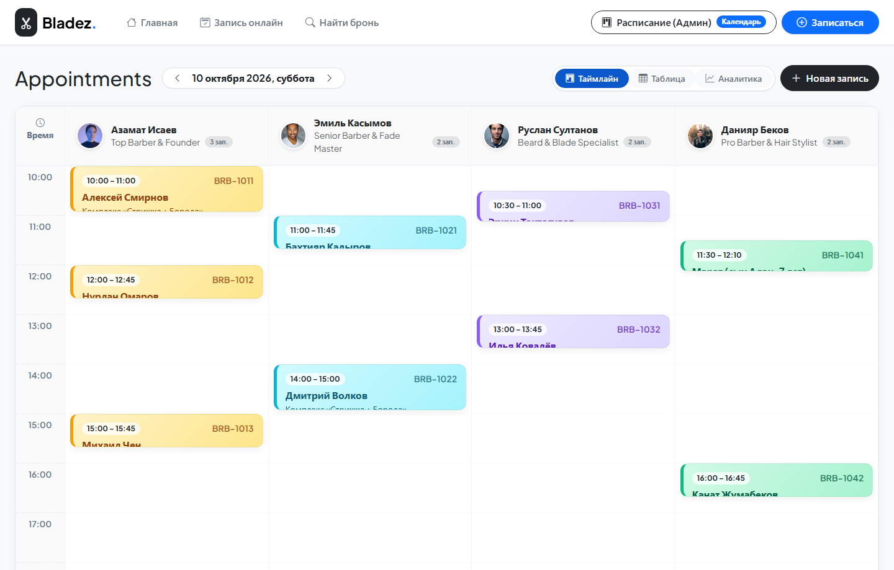
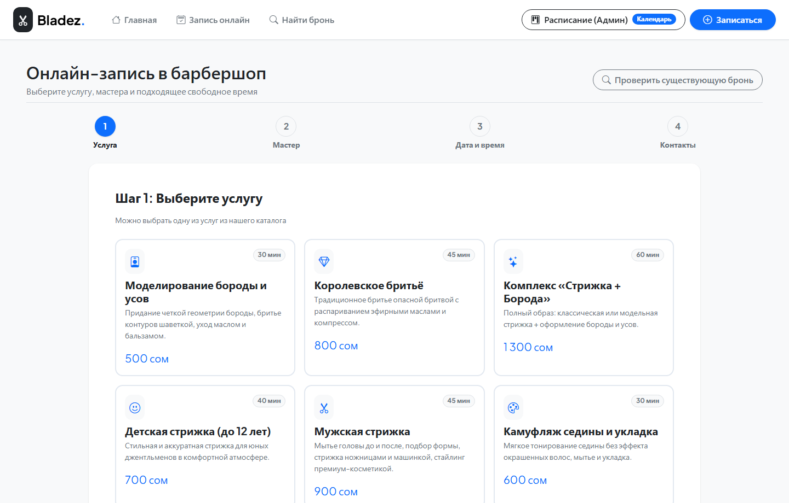
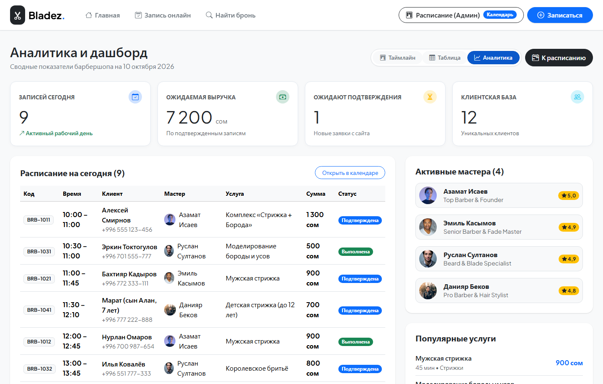
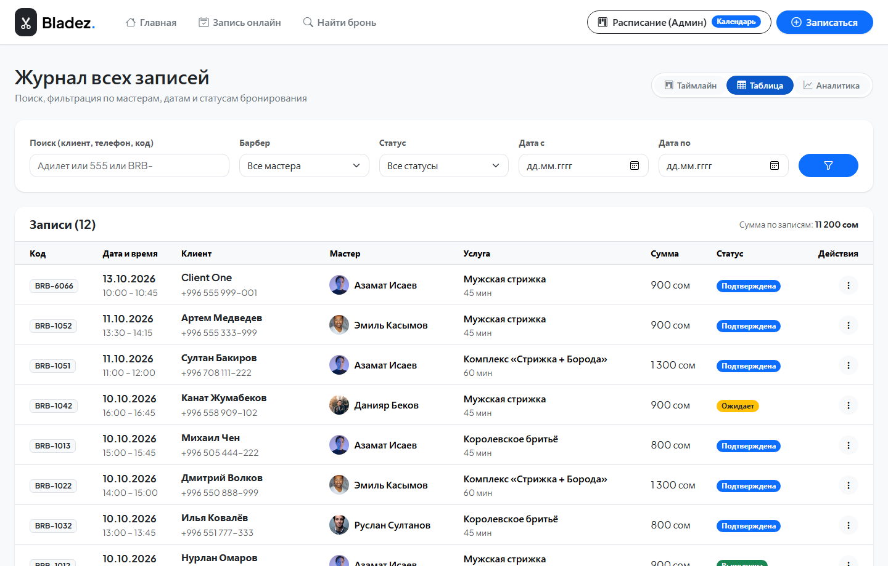

# BarberFlow (Bladez) — Сервис онлайн-записи клиентов для барбершопа


Полнофункциональное веб-приложение для барбершопа и салона красоты: **клиенты выбирают мастера, услугу и свободное время онлайн**, администратор управляет журналом визитов через **интерактивный таймлайн-календарь**, а система **гарантированно исключает накладки и двойное бронирование**.

---

## Скриншоты системы

### 1. Интерактивный таймлайн расписания (Appointments Timeline)
*Сетка мастеров по колонкам, временная шкала с 10:00 до 21:00, карточки записей в фирменных пастельных тонах мастеров, модальное управление статусами и быстрая запись.*



---

### 2. Главная страница барбершопа (Витрина & Прайс-лист)
*Стильный представительский лендинг с онлайн-прайсом в сомах, карточками команды барберов и кнопкой моментальной записи.*


---

### 3. Пошаговый визитер онлайн-записи (Booking Wizard)
*Клиентский 4-шаговый мастер: выбор услуги, барбера, даты с динамической загрузкой свободных слотов через AJAX и мгновенной валидацией.*



---

### 4. Аналитическая панель администратора (Dashboard)
*Сводка за день: выручка, подтвержденные записи, новые заявки, популярные услуги и загрузка команды.*



---

### 5. Журнал записей с фильтрацией (Табличный вид)
*Полный реестр визитов с фильтрами по датам, мастерам, статусам и строкой живого поиска.*



---

## Реализованный функционал

### Для клиентов:
- **Интерактивный пошаговый мастер бронирования (Wizard):**
  - **Шаг 1:** Каталог услуг с описанием, временем выполнения и ценами в сомах.
  - **Шаг 2:** Выбор мастера с фотографиями, рейтингом и специализацией.
  - **Шаг 3:** Выбор даты и динамический расчет свободных временных слотов. Недоступные и прошедшие слоты подсвечиваются и блокируются.
  - **Шаг 4:** Ввод контактов клиента (телефон в формате Кыргызстана `+996 ...`, имя, комментарий).
- **Электронный талон бронирования:** генерация уникального номера брони (`BRB-XXXX`) с выводом всех реквизитов визита.
- **Поиск и отслеживание записи:** клиент в любой момент может найти свою бронь по коду или телефону и при необходимости отменить визит.

### Для администратора:
- **Визуальный таймлайн расписания (Timeline):** наглядная сетка по мастерам с автоматическим позиционированием блоков записей по времени и продолжительности.
- **Управление статусами записей в один клик:** `Ожидает` → `Подтверждена` → `Выполнена` → `Отменена`.
- **Быстрая запись администратором (Quick Booking):** модальное окно для моментального добавления звонящего клиента прямо в расписание.
- **Управление базой мастеров:** учет рабочих дней недели, индивидуального времени смены и цветовой идентификации в календаре.
- **Каталог услуг:** управление стоимостью и длительностью процедур.
- **Аналитика:** оперативный расчет дневной выручки, числа завершенных записей и размера клиентской базы.

---

## Архитектура и надежность

### Защита от двойного бронирования (Double Booking Prevention)
Исключение пересечений реализовано на двух уровнях:
1. **Бизнес-логика слотов:**
   Формула проверки конфликтов интервалов `[StartA, EndA)` и `[StartB, EndB)`:
   $$\text{Conflict} \iff (\text{NewStart} < \text{ExistingEnd}) \land (\text{NewEnd} > \text{ExistingStart})$$
2. **Защита от Race Condition (одновременных запросов):**
   При сохранении брони операция выполняется внутри изолированной транзакции базы данных. При обнаружении конфликта система выбрасывает строго типизированное исключение `DoubleBookingConflictException` и возвращает HTTP `409 Conflict`, исключая запись двух людей на один слот даже при одновременном нажатии кнопки.

---

## Стек технологий

- **Язык & Платформа:** C# 12 / .NET 8 (LTS) & .NET 10
- **Веб-фреймворк:** ASP.NET Core MVC + RESTful API контроллеры
- **ORM & База данных:** Entity Framework Core 8, Pomelo.EntityFrameworkCore.MySql, MySQL Server 8.4
- **Фронтенд:** HTML5, CSS3, Bootstrap 5.3, Bootstrap Icons, Vanilla JavaScript, Google Fonts (Plus Jakarta Sans)
- **Транзакции & Надежность:** ACID транзакции, композитные индексы MySQL

---

## Структура проекта

```
BarberBooking/
├── BarberBooking.slnx               # Файл решения .NET
├── database/
│   └── schema.sql                   # Автономный SQL-скрипт создания схемы MySQL
├── screenshots/                     # Скриншоты системы для портфолио
│   ├── Timeline.png
│   ├── Home.png
│   ├── Booking.png
│   ├── Dashboard.png
│   └── Appointments.png
├── test_app.ps1                     # Автотест API, бронирования и Double-Booking
└── BarberBooking.Web/               # Веб-приложение ASP.NET Core
    ├── Program.cs                   # Точка входа, DI, миграции и автосидирование
    ├── appsettings.json             # Строка подключения к MySQL
    ├── Data/
    │   ├── BarberDbContext.cs       # Контекст EF Core, индексы, связи
    │   └── DbInitializer.cs         # Начальные данные: мастера, услуги, записи
    ├── Models/
    │   ├── Barber.cs                # Модель мастера
    │   ├── ServiceItem.cs           # Модель услуги
    │   ├── Appointment.cs           # Модель записи
    │   ├── AppointmentStatus.cs     # Перечисление статусов
    │   └── ViewModels.cs            # DTO для API слотов, формы и дашборда
    ├── Services/
    │   ├── IBookingService.cs       # Контракт сервиса бронирования
    │   └── BookingService.cs        # Логика генерации слотов и транзакций
    ├── Controllers/
    │   ├── HomeController.cs        # Главная страница барбершопа
    │   ├── BookingController.cs     # Виджет записи, API слотов, подтверждение
    │   └── AdminController.cs       # Таймлайн, дашборд, журнал, смена статусов
    ├── Views/
    │   ├── Home/                    # Представления главной
    │   ├── Booking/                 # Онлайн-запись, подтверждение, трекинг
    │   ├── Admin/                   # Таймлайн, аналитика, журнал, мастера
    │   └── Shared/                  # Общий макет (_Layout.cshtml)
    └── wwwroot/
        └── css/site.css             # Стили расписания, карточек и виджета
```

---

## Схема базы данных

```
  ┌──────────────┐                  ┌────────────────────────┐
  │   barbers    │ 1              * │      appointments      │
  ├──────────────┼──────────────────┼────────────────────────┤
  │ id (PK)      │                  │ id (PK)                │
  │ full_name    │                  │ booking_code (UNIQUE)  │
  │ title        │                  │ barber_id (FK)         │
  │ badge_color  │                  │ service_id (FK)        │
  │ working_days │                  │ client_name            │
  │ work_hours   │                  │ client_phone           │
  └──────────────┘                  │ appointment_date       │
                                    │ start_time / end_time  │
  ┌──────────────┐ 1              * │ price                  │
  │   services   │──────────────────┤ status (0,1,2,3)       │
  ├──────────────┼                  └────────────────────────┘
  │ id (PK)      │
  │ name         │
  │ price        │
  │ duration_min │
  └──────────────┘
```

---

## Запуск проекта

### Требования:
- .NET 8 SDK или выше
- СУБД MySQL Server 8.x (запущен на `localhost:3306`)

### Шаги запуска:
1. Клонируйте репозиторий:
   ```bash
   git clone https://github.com/TikTak-creator/BarberBooking.git
   cd BarberBooking
   ```

2. При необходимости скорректируйте пароль от MySQL в `BarberBooking.Web/appsettings.json`:
   ```json
   "ConnectionStrings": {
     "DefaultConnection": "Server=localhost;Port=3306;Database=barber_booking_db;User ID=root;Password=YOUR_PASSWORD;CharSet=utf8mb4;"
   }
   ```

3. Запустите проект:
   ```bash
   cd BarberBooking.Web
   dotnet run
   ```

4. Откройте в браузере:
   - Клиентская часть: **`http://localhost:5087`**
   - Онлайн-запись: **`http://localhost:5087/booking`**
   - Расписание администратора: **`http://localhost:5087/admin/timeline`**
   - Аналитика: **`http://localhost:5087/admin/dashboard`**

> **Примечание:** База данных `barber_booking_db` и таблицы создаются автоматически при первом запуске приложения, включая начальный набор мастеров, услуг и записей для демонстрации таймлайна.

---

## Автор
Разработано для портфолио: [TikTak-creator](https://github.com/TikTak-creator)
