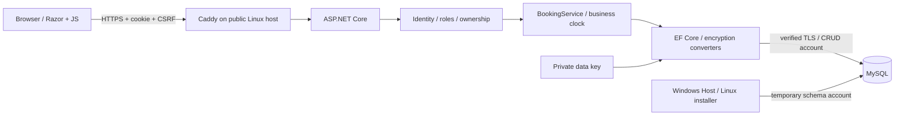

# Development / Разработка

## Build

Install .NET SDK **10.0.401**. The web app and Core target `net10.0`; the Windows host targets `net10.0-windows`. Packages are locked per project. MySQL is not required to compile.

```powershell
dotnet restore BarberBooking.slnx --locked-mode
dotnet build BarberBooking.slnx --no-restore
dotnet run --project Bladez.Tests
```

Windows integration tests download/check a private MySQL ZIP into `.artifacts`, create a unique profile/database on a free loopback port, apply migrations with a temporary account and revoke it before HTTP tests. They never use the system MySQL. Linux CI sets `BLADEZ_TEST_ADMIN_CONNECTION` to its own disposable TLS MySQL. Do not set that variable to a shared or production server: the fixture creates/removes test users and a test database. Assertions cover actual database ciphertext, concurrent booking, IDOR, CSRF, role scope, session revocation and genuine TOTP codes.

For interactive local operation use the Windows Host release or Linux installer. A raw `dotnet run --project BarberBooking.Web` intentionally fails without a configured database; there is no root-password fallback. `BLADEZ_DATA` selects the profile. A private `BLADEZ_CONNECTION_FILE` can supply a connection string for an administrator-controlled process. Do not use it as a browser setting. `--initialize` reads a bootstrap JSON document from stdin (or `BLADEZ_BOOTSTRAP_FILE`) and creates the first owner; `--migrate` only applies schema migrations. Both are offline process modes, not public HTTP endpoints.

## Request path



`Program.cs` configures persistent data-protection keys, Identity hashing, security stamps, cookies, forwarding restrictions, host filtering, CSRF, CSP, rate limits and database-key readiness. It never logs connection secrets to a browser. `PrivateNormalizer` maps email lookups to keyed fingerprints. `BookingAccess` authorizes either the exact customer account or an encrypted HttpOnly guest grant cookie.

`BookingService` is the authoritative booking boundary. Availability displayed to a browser is advisory: creation opens a transaction, locks the barber row with a parameterized `SELECT ... FOR UPDATE`, rechecks date, grid, working hours, lead time, horizon, status and time off, then saves. This prevents the empty-schedule race. Status/reschedule/cancel operations require a matching appointment `Version`. Price, duration and service name come from the catalog and are snapshotted on the appointment; clients cannot choose the charge by editing JSON.

`ShopClock` uses the configured IANA business time zone, not the browser clock. Stored appointment dates/times describe local shop wall time. Audit timestamps are UTC. Changing the shop time zone is blocked while future live appointments exist. Time intervals are half-open: a visit ending at 11:00 does not conflict with one starting at 11:00.

The schedule serializes already-scoped DTOs into Razor-encoded `data-appointment` attributes. JavaScript parses them and uses `textContent`; customer text never becomes an event handler. A barber's contact masking happens in the server DTO. Hiding a button is never the authorization check.

## HTTP contracts

These are session-based website endpoints. They are not a token-based public API product. An external authorized client must maintain its own cookie jar, obtain the anti-forgery token from a page, submit `X-CSRF-TOKEN` on unsafe requests and obey account/role scope. Do not share session cookies or disable CSRF for integration convenience.

| Request | Access / payload |
|---|---|
| `GET /api/booking/slots?barberId=1&serviceId=1&date=YYYY-MM-DD` | Public availability only: times, available flag, generic reason; no contacts |
| `POST /api/booking/create` | Customer session by default; optional owner-enabled guests. JSON `barberId, serviceId, date, timeSlot, clientName, clientPhone, clientEmail?, notes?` + CSRF |
| `GET /Booking/Confirmation?code=...` | Exact customer ownership or separate guest grant; otherwise 404 |
| `POST /Booking/Track` | `code, key` + CSRF; locator alone is insufficient |
| `POST /Booking/Cancel` | `code, version, reason?` + ownership, cutoff and CSRF |
| `GET /admin/timeline?date=YYYY-MM-DD` | Staff, with server-side barber scope |
| `POST /admin/update-status` | Authorized staff; `id, status, version` + CSRF, transition/time checks |
| `POST /admin/reschedule` | Owner/reception; inspect the current view/controller field names; CSRF, version and conflict checks |
| `GET /health/live` | Minimal liveness, no secrets |
| `GET /health/ready` | 200 only when the database and matching data key are available; otherwise 503 |

Booking failures use 400 (invalid input), 401 (login needed), 409 (conflict) or 429 (limit). Confirmation never leaks contacts for a guessed locator. HTML admin failures normally use login/access-denied redirects; JSON `/api` auth failures use 401/403.

## Migrations and encryption

EF migrations live in `BarberBooking.Web/Data/Migrations`. `DesignTimeFactory` uses a dummy connection and a temporary design key, not real credentials. Install matching `dotnet-ef 10.0.13` locally, then use `dotnet ef migrations add NAME --project BarberBooking.Web`. Review generated SQL before upgrades. Only the setup/maintenance migrator has DDL rights; normal web requests do not.

Converters in `BarberDbContext` bind encryption purposes to fields. Changing a purpose breaks decryption of existing values; changing the key also invalidates HMAC indexes. Plan and test an explicit re-encryption migration before either change. Do not add a plaintext fallback. Do not index randomized ciphertext for exact contact search: query an authorized bounded set and filter decrypted fields, or add a deliberately designed keyed lookup.

Windows physical backups rewrap the portable data key under the destination user's DPAPI and update CA paths. Linux uses its own authenticated archive format. Both stop MySQL before copying and require an empty destination. Restore is not a substitute for a reviewed cross-platform logical data migration.

## Contributing

Use `redbox/` feature branches, preserve `main` history and do not commit profiles, `.env`, downloaded binaries or secrets. Keep app assets local. Add meaningful checks when changing booking/authorization/storage rules; avoid tests that merely repeat markup. Re-run responsive browser checks when changing views. Existing `screenshots/` files are from the legacy demo and should not represent the business release; the new gallery is in `docs/screenshots/`.

Feature boundaries: payment/SMS, multi-location tenancy, general API credentials, catalog import from the old snake_case schema and a Windows service require separate design. Do not label these complete because an empty adapter or settings field exists.
