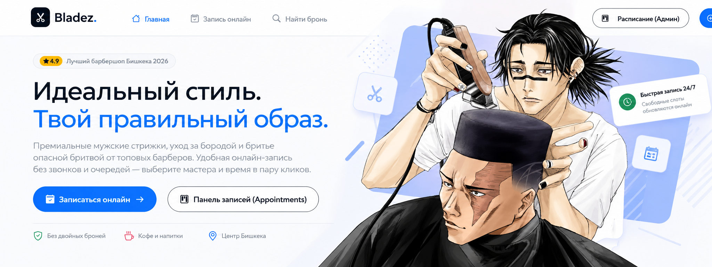

<b>Простая запись для клиента. Рабочее пространство для бизнеса.</b>

<a href="README.md">English</a> · <a href="https://github.com/TikTak-creator/BarberBooking/releases">Скачать</a> · <a href="docs/USER-GUIDE.md">Установка и работа</a> · <a href="docs/DEVELOPMENT.md">Для разработчиков</a>

   

**Bladez** — система онлайн-записи для барбершопа с аккаунтами клиентов, рабочими ролями, наглядным расписанием и собственной базой MySQL. Портфолио-демо переработано: доступ проверяется на сервере, контакты шифруются, одновременные запросы на одно время проходят проверку внутри транзакции.

Изображение сверху — **только баннер документации**. Скриншоты показывают настоящий интерфейс. Приложение работает на русском; документация рассчитана и на пользователей, и на разработчиков.

## Что умеет система

| Для клиента | Для команды | Для владельца сервера |
|---|---|---|
| Запись в 4 шага: услуга → мастер → время → контакты | Расписание, карточки визитов, статусы | Мастер настройки Windows с отдельным MySQL |
| Личный кабинет, история и доступная по правилам отмена | Владелец, ресепшен и барбер со своим расписанием | Установка Linux/VPS с HTTPS |
| Пароль и необязательный второй фактор через приложение-аутентификатор | Прайс, рабочие часы, перерывы, журнал действий | Зашифрованные резервные копии |

**Общего пароля администратора нет.** При установке вы создаёте владельца. Можно добавить пример каталога: два мастера и три услуги, без вымышленных клиентов и записей. Перед началом работы замените пример своим прайсом и командой.

## Установка без программирования

Откройте [релизы](https://github.com/TikTak-creator/BarberBooking/releases) и выберите комплект.

1. **Windows 10/11 x64:** запустите `Bladez-Setup-1.0.0.exe`, откройте **Bladez Host**, укажите название, владельца и пароль, нажмите **Настроить и запустить**. Программа скачает официальный MySQL (~281 МБ), проверит SHA-256, создаст отдельную базу и ключи. .NET включён. При необходимости подписанный компонент Microsoft VC++ запросит права администратора.
2. **Linux x64 / VPS:** распакуйте комплект с исходниками, перейдите в `deploy/linux`, запустите `sudo bash install.sh`. Мастер спрашивает домен и владельца, настраивает MySQL и HTTPS через Caddy. На Ubuntu/Debian может установить Docker из официального репозитория с проверкой ключа подписи. Домен, DNS и доступность портов 80/443 обеспечивает владелец VPS.
3. **Source ZIP:** исходный код для изучения, изменений и собственной сборки.

Windows по умолчанию работает локально на `127.0.0.1`, пока открыто окно или значок Host в трее и выполнен вход в Windows. Для постоянного публичного сайта предусмотрен Linux/VPS. Подробности, остановка, обновление и восстановление — в [руководстве](docs/USER-GUIDE.md).

## Посмотреть приложение

Большая галерея настоящих экранов готовится вместе с релизом: [все скриншоты](docs/SCREENSHOTS.md).

## Роли

| Возможность | Владелец | Ресепшен | Барбер | Клиент |
|---|:---:|:---:|:---:|:---:|
| Расписание | Всё | Всё | Только своё | — |
| Быстрая запись и перенос | ✓ | ✓ | — | Своя онлайн-запись |
| Завершение / неявка | ✓ | ✓ | Свои прошедшие визиты | — |
| Услуги, команда, настройки | ✓ | — | — | — |
| Контакты клиента | ✓ | ✓ | Телефон скрыт частично | Только свои |
| Свои записи и отмена по правилам | ✓ | ✓ | ✓ | ✓ |
| Второй фактор входа | ✓ | ✓ | ✓ | ✓ |

Первый пароль сотрудника временный: до его смены остальные страницы закрыты. Блокировка аккаунта прекращает действующие сеансы. Один код брони не даёт доступа к контактам. Для необязательной гостевой записи создаётся отдельный секретный ключ.

## Защита без обещаний невозможного

Пароли хранятся в виде PBKDF2-хешей ASP.NET Core Identity. Контактные поля и секреты аутентификатора шифруются AES-256-GCM. Ключ находится отдельно от MySQL: в Windows он защищён DPAPI текущего пользователя, в Linux — правами на файлы. Обычный аккаунт базы умеет только читать и изменять данные; миграции выполняются временным отдельным аккаунтом. Подключение к MySQL проверяет TLS-сертификат.

На сервере действуют проверки ролей и владельца записи, CSRF, ограничения запросов, версии изменений, блокировка строки мастера при бронировании и CSP для скриптов. Паролей базы и ключа шифрования в JavaScript нет.

**DevTools видит данные, которые разрешено получить вошедшему пользователю.** Скрыть от владельца браузера его собственный экран невозможно. Шифрование также не защищает от администратора ОС или вредоносной программы с правами пользователя сервера. Нужны обновления, закрытый доступ к хосту и проверенные резервные копии. [Модель безопасности](docs/SECURITY.md).

## Разработчикам

**C# / .NET 10 · ASP.NET Core MVC + JSON · Identity · EF Core 10 · официальный Oracle MySQL provider · MySQL 8.4 LTS · Bootstrap 5.3 · JavaScript · Windows Forms · Docker Compose · Caddy.**

| Папка | Назначение |
|---|---|
| `BarberBooking.Web` | Контроллеры, правила записи, Identity, миграции, Razor-интерфейс |
| `Bladez.Core` | Шифрование, приватные файлы, собственный MySQL, управление сервером, копии |
| `Bladez.Host` | Мастер настройки и окно управления Windows |
| `Bladez.Tests` | Проверки на отдельной настоящей MySQL |
| `deploy/linux` | Установка VPS, HTTPS, обслуживание и резервирование |
| `deploy/windows` | Определение установщика и сборка релиза |

Для сборки нужен SDK .NET 10.0.401: `dotnet build BarberBooking.slnx`. Используйте новую базу и профиль, а не старую демо-базу. Архитектура, запуск и контракты запросов описаны в [документации разработчика](docs/DEVELOPMENT.md). Проверки охватывают двойную запись, роли, доступ к чужой брони, шифрование в MySQL, CSRF и настоящий TOTP.

История `main` сохранена. Ветка новой версии: `redbox/business-release`.

## Границы проекта

Реализованы аккаунты, роли, MFA, каталог, жизненный цикл записи, расписание, перерывы, аудит и собственный хост. SMTP для писем аккаунта подключается по настройкам вашего почтового сервера.

SMS-проверка номера, оплата, касса/налоги и сеть филиалов пока не реализованы. Номер телефона не считается подтверждённым. Владелец задаёт реальные сведения, правила записи, сроки хранения данных и текст приватности. Это программный инструмент, а не сертификат соответствия требованиям законодательства. [Сторонние компоненты и баннер](docs/THIRD-PARTY.md).
